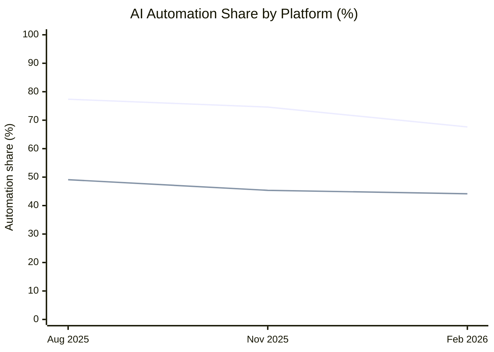

# Automation Gap

The **automation gap** measures the difference between how often businesses and individual consumers use AI to **automate** work rather than **augment** human work. In our Anthropic Economic Index research, enterprise API usage represents business-oriented AI interactions, while Claude.ai represents consumer interactions. Automation includes *directive* and *feedback-loop* interactions; augmentation includes *learning*, *task iteration*, and *validation*. We calculate the gap by subtracting the consumer automation share from the API automation share, in percentage points. A positive gap means API interactions are more automation-heavy. This tells us about **patterns of AI use**, not whether particular jobs have been replaced.

## Automation share across three releases

**Lines (in order):** Enterprise API (upper line); Claude.ai consumers (lower line).

**Graph explanation:** Enterprise API interactions were more automation-heavy than consumer interactions in every release shown. The difference was **28.27 percentage points** in August 2025, **29.25 points** in November 2025, and **23.47 points** in February 2026. Overall, the gap narrowed by **4.80 points** from August to February, mainly because API automation share declined more than consumer automation share. These are **overall platform-level shares**, not yet comparisons restricted to identical tasks; changes in the mix of tasks could contribute to the pattern.

---
